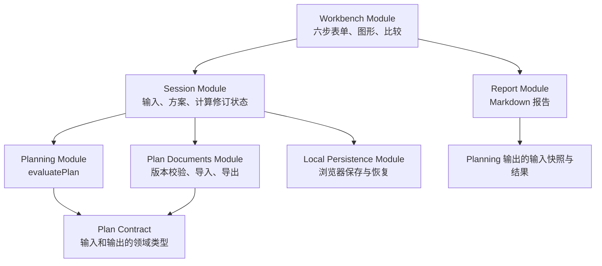

# FIRE Module 设计

状态：基于已确认的四轮需求形成的架构设计，尚未实现或性能验证。本文件不替代产品与计算规格，也不将技能调用视为开始应用实现的整体确认。

## 1. 设计依据

- [产品规格](product-spec.md)：六步引导、双方案比较、实时图形和本地方案管理。
- [计算规格](calculation-spec.md)：月度现金流、资金目标、达标搜索、追加投入和压力测试。
- [领域术语](../GLOSSARY.md)：统一财务用语；技术设计概念留在本文。

当前目录仅包含规格、视频资料与处理脚本，没有既有网页代码、框架配置或需要兼容的网页 Module。本设计适用于新建 React + TypeScript + Vite 应用。

## 2. 核心决定：让复杂计算集中在深 Module

将 **Planning Module** 放在表单数据与计算结果之间的 Seam。它的 Interface 接收一份完整方案草稿，返回结构化结果；其 Implementation 隐藏校验、月份换算、收支编排、六组情景、资金守恒、数值搜索和结果解释。

页面、图形和报告不能分别维护退休资金公式；调用者也不用按顺序调用校验、生成时间轴、求目标和求达标月份。

用技能中的术语描述：

- **Module**：拥有一套完整 Interface 与 Implementation 的功能组织。
- **Interface**：包含输入、输出、不变量、错误模式和运行特性，而不只是一条 TypeScript 函数声明。
- **Seam**：调用者可以通过输入改变计算行为，而不编辑页面或计算内部代码的位置。
- **Depth**：一次调用可获得完整规划能力，而无需学习内部计算顺序。
- **Leverage**：六步界面、两类社保方案、图形和报告复用相同计算。
- **Locality**：现金补足或养老金计入规则变化时，规则及其验证集中在 Planning Module。

## 3. Module 及依赖方向



箭头表示允许的依赖，不代表每次交互都执行全部操作。Planning 不依赖 React、浏览器存储、当前系统时间、随机数、网络或报告样式；基准年月与假设来自输入。

| Module | Interface 主要内容 | 隐藏的 Implementation | 删除测试 |
| --- | --- | --- | --- |
| Planning | `evaluatePlan(draft)` | 解释输入、月度模拟、资金反求、情景组织、可读原因 | 删除后，公式与计算顺序会散落到表单、报告和比较调用者中 |
| Session | 状态与用户意图 | 草稿、合法值提交、方案切换、计算修订、保存状态 | 删除后，每一步都要自行处理草稿与旧结果对应关系 |
| Plan Documents | `decodePlanFile` / `encodePlanFile` | 不可信 JSON、版本识别、迁移、结构和范围检查 | 删除后，恢复、导入与导出会分别理解文件格式 |
| Local Persistence | `restoreWorkspace` / `saveWorkspace` | 存储损坏、容量失败、浏览器存储不可用 | 删除后，存储异常会泄漏到多处页面 |
| Report | `renderMarkdownReport(snapshot)` | 排版、假设说明、来源、缺失结果表达 | 删除后，页面需逐项组织报告文本 |
| Workbench | 用户操作与可访问交互 | 六步布局、输入控件、SVG 映射和动效 | 删除后失去交互，但金融规则仍在 Planning 中 |

不是每个 Module 都必须一样深。文档格式与浏览器 I/O 有独立的失败模式，值得集中；纯粹转调下一层的 `RetirementService` 等不另建。

## 4. Planning 的小 Interface

以下代码用于说明形状，属于设计，尚非已实现的类型声明。

```typescript
export function evaluatePlan(draft: PlanDraft): PlanEvaluation;

type PlanEvaluation =
  | {
      kind: 'needs-input';
      issues: readonly FieldIssue[];
      preview: PartialPreview;
    }
  | {
      kind: 'invalid';
      issues: readonly FieldIssue[];
    }
  | {
      kind: 'evaluated';
      snapshot: PlanSnapshot;
      cases: readonly CaseEvaluation[];
      modelVersion: string;
    };

type CaseKey = {
  coverage: 'continue' | 'stop';
  returns: 'conservative' | 'baseline' | 'optimistic';
};

type CaseEvaluation = {
  key: CaseKey;
  outcome: CaseOutcome;
};

type CaseOutcome =
  | { kind: 'needs-input'; issues: readonly FieldIssue[] }
  | { kind: 'evaluated'; result: CaseResult }
  | { kind: 'unresolved'; reason: SolverIssue };
```

### 输入

PlanDraft 是有领域含义的结构，而不是页面控件值的任意字典：

- 基准年月、当前年龄、希望退休时间、规划终点。
- 个人/家庭统计范围。
- 当前与退休预算轨道、完整预算替换节点、一次性支出。
- 工资与其他净收入、起止时间和增长口径。
- 当前资产、目标配置、房产说明、债务付款。
- 购买/不购买社保医保两组安排。
- 通胀、收益三情景、提取率、缓冲和冲击假设。
- 可选的手动资金目标，只作比较。

空白字段用明确的未填写状态表示，合法零值保留为 0。控件编辑过程中的 `-`、小数点和空字符串是 Session 的编辑状态，不直接冒充有效金额。未知养老金、明确没有养老金、已填写养老金为不同状态。

输入块虽然覆盖的领域多，但不要求调用者理解内部求解顺序。不通过拆成二十个公开函数来营造函数数量少以外的虚假 Depth。

### 输出

每个可计算 CaseResult 包含：

- 希望退休时间的预计资产、提取率参考本金、全程需求、推荐总目标及缓冲拆分。
- 最早达标时间的独立状态：现在/未来月份/规划期内未达标。
- 追加投入的独立状态：无需追加/每月金额/立即一次性补足/无法在搜索范围求解。
- 希望退休路径与最早达标路径，始终标明对应的退休起点；未达标时不伪造第二条路径。
- 基准收益情景的退休首月压力测试，始终说明使用的起点与资金；不把该冲击机械复制为三种不同收益情景下的六份相同基准测试。
- 月度图表数据、有效事件标记、缓冲不足和付款不足记录。
- 带稳定原因代码、字段/事件定位信息及单位的解释数据。

六个 CaseKey 显式出现，不能用数组顺序隐含两种社保方案和三种收益。一个社保方案缺养老金估计时，返回该 Case 的 needs-input，另一方案可以继续计算。共同必填信息缺失才在整体层返回 needs-input。

FieldIssue 用字段路径和稳定事件 ID 定位，未来排序、拖动和翻译不改变定位。模型错误不使用本地化字符串作唯一标识；中文展示文案归 Workbench 与 Report。

### 不变量与失败模式

- 相同草稿与 modelVersion 得到相同结果，不读外部可变状态，不修改输入。
- 不返回 NaN、Infinity 或用负资产继续赚收益。
- “资金不足”“未达标”是正常规划结果，和数值求解范围不足分开。
- 输入字段无效返回定位问题；预期内失败不依靠异常控制正常页面流程。意外程序错误由应用错误处理接住，不能伪装成用户未达标。
- CaseResult 金额带时间点和名义口径；显示为今天购买力由统一转换完成。不能直接把退休年的名义金额与今天资产对比。
- snapshot 包含本次实际使用的输入及假设；报告与比较不能拿旧结果配新输入。

## 5. Planning 内部组织

内部文件是 Implementation 组织，不自动成为可供调用者依赖的 Interface：

```text
planning/
  index.ts                # 唯一外部计算入口和类型出口
  contract.ts             # PlanDraft、结果状态、领域单位
  evaluate.ts             # 六组情景编排
  internal/
    validate.ts           # 缺失、矛盾、非法与有效零值
    compile-timeline.ts   # 月份、预算替换、工资停止、养老金起领
    simulate.ts           # 现金与投资账户、事件付款、月收益
    solve.ts              # 目标本金、追加月投入、逐月达标扫描
    explain.ts            # 原因代码与数据定位
    policy.ts             # 默认值和明确计算限制
```

`validate → compile → simulate/solve` 的顺序只由 evaluate 管理。不同退休起点改变工作状态与退休预算，固定婚育、债务、养老金事件保持原时间；不能把基准退休日期的所有现金流编译成唯一不可修改的时间轴后用于全部候选。

月度模拟是唯一资金变动 Implementation。正常路径、反求目标、追加月投入和压力测试共享它，不能为了提速再手写一份近似资金公式并对外使用相同标签。

求解器内部允许有小函数和 internal seams，但调用者只跨 Planning 的外部 Seam。不要为每个求解步骤定义可注入插件。

## 6. 运行成本与实时反馈

完整评估最多覆盖两种保障方案、三组收益、逐月退休候选和资金反求。首次实现需要测量运行时间；“所有输入实时计算”不等于允许每次拖动都同步阻塞主线程。

Implementation 优先优化：

1. 预计算月度通胀、固定节点和与候选退休时间无关的现金流。
2. 不为每个反求试探保存整条曲线，仅保留约束检查摘要；最终所需路径才输出月度数据。
3. 缓存一次评估内的编译数据与重复候选结果；不给调用者手动清缓存的职责。
4. 退休月份按顺序扫描，不能假设目标随年龄单调。只有经过验证满足单调前提的资金数值问题才使用二分。
5. 数值搜索限制迭代次数、上界和精度，所有求解结果必须正向复核。

这些是实现策略，不更改计算规格。桌面与手机需要记录输入到有效结果的耗时；具体性能数字只有测量后才能声称通过。

Session 为每次有效草稿生成递增 revision，结果只能绑定同一 revision 的快照。快速输入时可合并待执行计算；旧结果保留但标记“正在更新/待完成输入”，禁止旧结果覆盖新修订。

第一版先保持纯计算入口。若测得主线程耗时影响拖动，直接在真实 Worker 中执行相同 evaluatePlan；Session 的计算修订状态保持不变。未用到 Worker 前不引入两个空壳 Adapter 或调度框架。Worker 投递、返回、销毁和忽略旧消息需实际浏览器测试。

## 7. Session 与六步 Workbench

Session 的 Interface 是“当前状态 + 用户意图”，Implementation 可使用 reducer 和 React hook，不暴露存储键、求解器步骤或图表坐标。

用户意图包括编辑字段、移动节点、切换步骤、命名/复制方案、选择比较对象、导入和导出。字段提交使用有类型的路径或按领域分组的 action，不用无限制 `set(path: string, value: any)` 让所有控件绕过类型约束。

状态分开记录：

- 正在编辑的字段字符串、字段错误与合法领域草稿。
- 当前方案 ID、输入 revision、激活步骤和图表焦点。
- 最近一次计算状态、对应 snapshot/revision 和进行中的修订。
- 当前保存 revision、未保存/保存成功/存储失败状态。

Workbench 内部可拆成六步视图、金额输入、节点编辑、图表和比较表。它们属于同一 Module 的 Implementation，不能因有多个视图就引入多套金融状态。

数字输入和滑块共享一个有效领域值。滑块可见范围不等于金额合法上限；精确输入超出快捷范围时不截断。SVG 仅把 Planning 输出映射为坐标，图形中不再计算退休目标或追加投入。

部分预览只展示有充分输入依据的现有资产、已知预算或时间标记，不输出看似完整的退休结论。

## 8. 方案文件、存储与报告

Plan Documents 的文件 Interface 包含格式版本、规划基准年月、方案 ID 与输入；不把图表像素坐标、输入中间态、旧计算缓存当作长期真相。导入恢复必须重新通过 evaluatePlan 计算，模型版本变化时允许结果改变并说明。

```typescript
decodePlanFile(value: unknown): DecodeOutcome;
encodePlanFile(document: PlanDocument): string;
renderMarkdownReport(snapshot: ReportSnapshot): string;
```

decode 既用于外部 JSON，也用于本地恢复，统一迁移和校验规则。不信任 JSON 内声称的合法类型、收益范围或嵌入结果。保留“历史支持版本可迁移”和“未知未来版本不能解释”的区别。

Local Persistence 接受浏览器 Storage 依赖，而不在 Module 内硬编码访问全局。生产使用浏览器真实存储，测试使用实际的内存 Storage Adapter，验证成功与配额/不可用等失败路径；这是一处已有两种实际用途的 Seam。文件的 JSON 导入导出不冒充第二种存储 Adapter，因为它不是相同操作语义。

保存失败不能删除内存方案；导入新方案默认建立副本，覆盖与重置由明确用户动作触发。外部报告/方案名称作为文本处理，页面不执行导入内容。

Report 接受同一次评估的输入快照、结果和模型版本，不接收当前可变草稿，不重新求解。报告不可计算的字段显示原因，不自动填零。名义/购买力单位由共享展示格式规则处理，而不是报告复制金融公式。

## 9. 建议目录

```text
src/
  app/                    # 入口、错误处理、样式入口
  planning/               # 纯计算深 Module
  session/                # 草稿、方案和修订生命周期
  plan-documents/         # 版本化导入导出
  local-persistence/      # 浏览器存储及错误处理
  report/                 # Markdown 渲染
  workbench/
    steps/                # 六步引导
    inputs/               # 金额与节点控件
    visuals/              # SVG 资产柱、曲线、时间轴
    comparison/           # 结果比较视图
  display/                # 金额、年龄、日期的展示规则
tests/
  planning/               # 跨外部 Interface 验证模型
  documents/              # 文件解码和保存恢复
  browser/                # 真浏览器工作流
```

这是导航建议，不要求实现第一天创建所有空目录。无 `services/`、`managers/` 或无归属的 `utils/` 中转层。不把原始视频和抽帧复制进网页构建资源；它们保留为设计参考。

## 10. 测试穿过同一 Seam

Planning 依赖均为 in-process 纯计算，直接从 index 导入 evaluatePlan，用真实输入断言公开结果，不注入假的养老金计算器或假的资金模拟器。

| 测试重点 | 从 Interface 观察的证据 |
| --- | --- |
| 无收益无通胀的有限年限 | 全程需求与逐月支出总和一致，缓冲没有额外加两次 |
| 婚育预算替换 | 节点前后月度开销及目标变化正确 |
| 退休晚于/早于某节点 | 节点日期不移动，工作收入和退休预算切换正确 |
| 养老金较晚生效 | 退休早期缺口保留，领取后减少 |
| 两个社保方案 | 未继续缴费不删除已有待遇；未知待遇只阻塞相关 Case |
| 股息和利息 | 组合总回报与外部收入不重复 |
| 现金补足 | 结果月度资金流水中内部转移不增加总资产 |
| 追加投入求解 | 使用返回的投入重新评估可满足条件，更低投入在精度范围外不能满足 |
| 压力冲击 | 仅对应资产受冲击，同月无重复常规收益 |
| 中途缺口/未达标/搜索范围不足 | 正确的不同状态，无 NaN 或伪造年龄 |

为方便验证现金守恒，月度结果保留现金、各类投资余额、外部净流入、回报、内部划转和不足金额。它们也支持结果解释，是有用户用途的输出，不是将内部对象专供测试暴露。

Plan Documents 和 Local Persistence 验证损坏 JSON、版本迁移、合法零值、保存失败不丢数据以及恢复后重算。

浏览器验证真实滑块、数字输入、阶段拖动、手机键盘遮挡、社保切换、快速输入旧结果不得覆盖、减少动态效果、方案复制与导出。不能用“计算测试通过”替代这些用户交互证据。

## 11. 暂不引入的 Seams

- 不定义可替换投资引擎、行情源、养老金供应商或云同步 Adapter；首版没有这些真实变化。
- 购买与不购买社保医保是领域输入差异，不是两套模拟器 Adapter。
- 收益三情景是数据，不是三种插件 Implementation。
- 不为每个字段或每一步提供求解方法。
- 不让 Report、SVG 或存储反向依赖 Workbench。

## 12. 实现顺序与验收

整体方案获得实现确认后：先完成 Plan Contract 和 Planning Interface 的少量完整案例，再接入 Session 与六步引导，然后完成视觉联动、方案文件、比较和报告。测试随可观察行为推进，不先铺满所有私有函数。

验收除产品要求外，应确认：所有公式在 Planning 内；无跨步骤调用顺序要求；输入、结果、报告和保存版本对应一致；资金与时间单位明确；实测实时交互性能；没有为假想变化建空壳抽象。

目前交付的是架构文档，未执行应用构建、金融计算测试或浏览器验证。
